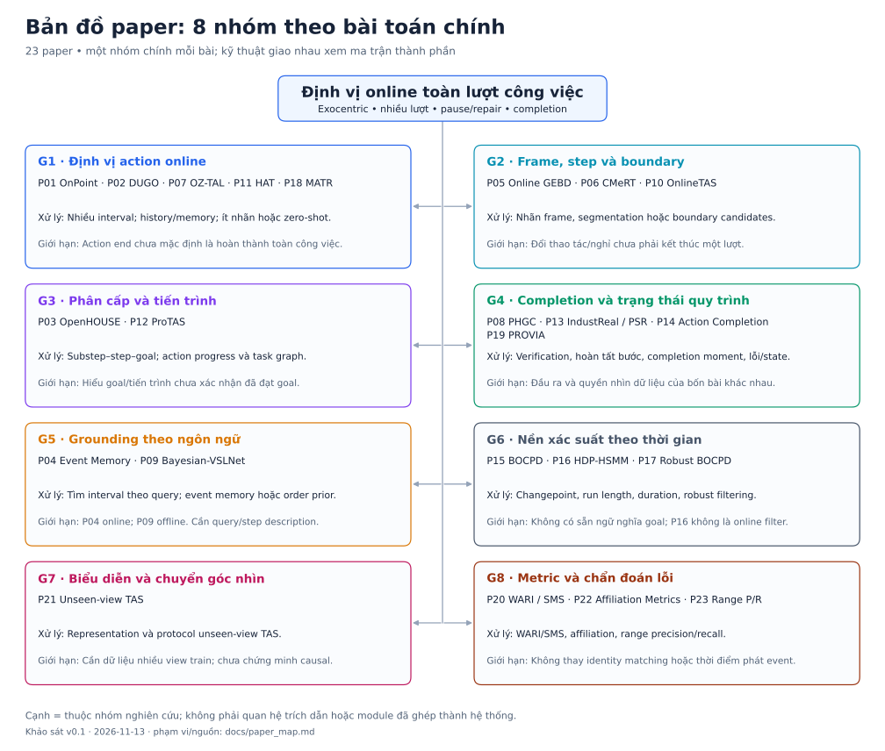
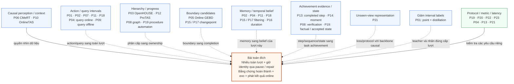
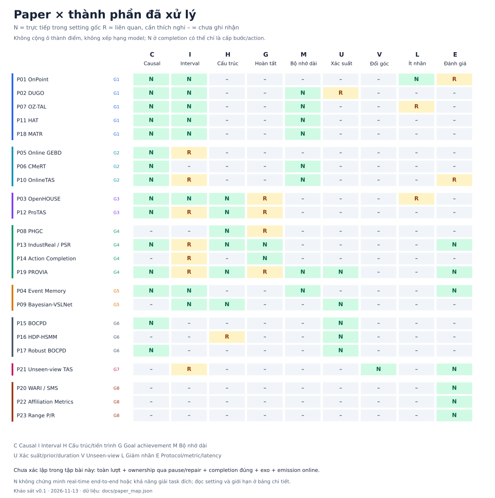

# Bản đồ paper và thành phần được xử lý

Cập nhật **2026-11-13**, bản phân loại v0.1 của **23 PDF hiện có**. Mục tiêu là quyết định đọc bài nào để xử lý vấn đề nào của [bài toán online, exocentric, toàn lượt](problem.md). Đây là bản đồ nghiên cứu định tính, **không phải citation graph, systematic review hay kết quả tái lập**. Cạnh biểu diễn quan hệ thuộc nhóm hoặc liên quan tới thành phần, không khẳng định paper này xây trên paper kia.

Phạm vi hình/ma trận trên trang là tập **P01–P23**. [9 bài bổ sung A01–A09 từ danh sách người dùng](paper_additions.md) đã được phân tích và đưa vào [roadmap cập nhật](reading_order.md), chưa gộp vào hình 23 bài này. Xem cả tập bổ sung trước khi diễn giải khoảng trống hoặc chọn nhánh state/graph.

## 1. Graph gom nhóm theo bài toán chính



[Mở SVG để phóng to/xuất hình](figures/paper_taxonomy.svg). Mỗi bài nằm trong **một nhóm chính** để dễ đọc; một kỹ thuật có thể xuất hiện ở nhiều thành phần trong ma trận bên dưới. P19 nằm ở nhóm state/completion nhưng cũng có segmentation, filtering và protocol. P01 thuộc On-TAL nhưng cũng xử lý chi phí nhãn. Việc xếp nhóm không giới hạn cách dùng bài.

| Nhóm | Bài | Đầu ra/thành phần gốc cần phân biệt |
| --- | --- | --- |
| G1 — Định vị action online | P01 OnPoint, P02 DUGO, P07 OZ-TAL, P11 HAT, P18 MATR | Các action intervals theo luồng; có nhánh ít nhãn, zero-shot và memory. |
| G2 — Frame, step và boundary | P05 Online GEBD, P06 CMeRT, P10 OnlineTAS | Lần lượt là boundary, nhãn frame và temporal segmentation; không đồng nhất ba đầu ra này. |
| G3 — Phân cấp và tiến trình | P03 OpenHOUSE, P12 ProTAS | Substep/step/goal description hoặc action progress/task graph. |
| G4 — Completion và state | P08 PHGC, P13 IndustReal/PSR, P14 Action Completion, P19 PROVIA | Lần lượt: verification theo luật, completed step, completion moment và mistake alarms/procedure state. |
| G5 — Grounding theo ngôn ngữ | P04 Event Memory, P09 Bayesian-VSLNet | Query → interval; P04 online, P09 offline. |
| G6 — Nền xác suất | P15 BOCPD, P16 HDP-HSMM, P17 Robust BOCPD | Run-length/change belief, explicit duration, robust filtering; không có sẵn ngữ nghĩa goal trong video. |
| G7 — Chuyển góc nhìn | P21 Unseen-view TAS | Representation và protocol cho camera chưa thấy, không phải completion detector. |
| G8 — Metric | P20 WARI/SMS, P22 Affiliation, P23 Range P/R | Chẩn đoán segmentation/range và metric gaming; không phải model phát hiện lượt. |

## 2. Graph thành phần: đọc nhánh nào để giải quyết việc gì?

Graph dưới là **quan hệ paper → thành phần**, không phải kiến trúc đã triển khai. Cạnh nét đứt biểu diễn liên quan/cần chuyển cấp hoặc thiết kế lại.



Không suy ra rằng ghép các nhánh sẽ tự giải xong bài toán. Ví dụ memory có thể giúp truy hồi start nhưng chưa giữ đúng identity của một sản phẩm qua pause; verification có thể xác nhận video đúng luật nhưng chưa chỉ ra thời điểm có đủ bằng chứng để phát completed.

## 3. Ma trận paper × thành phần



[Mở SVG để phóng to/xuất hình](figures/paper_coverage.svg).

- **N**: trực tiếp xử lý/đánh giá thành phần trong **setting gốc**. Không có nghĩa giải quyết thành phần ở cấp toàn lượt của dự án, cũng không chứng minh real-time end-to-end.
- **R**: có kỹ thuật/đầu ra liên quan nhưng khác cấp, khác ý nghĩa hoặc giả định; cần thích nghi và kiểm chứng.
- **–**: chưa ghi nhận là phần được bài xử lý trong khảo sát này. Không có nghĩa tác giả không thể mở rộng hoặc khẳng định không có nghiên cứu khác.

Không cộng số ô N/R để chấm điểm hay xếp hạng paper. Không dùng số benchmark khác metric/dataset để xác định nhóm tốt nhất.

| Cột | Thành phần và quy tắc đọc |
| --- | --- |
| C | **Causal**: quyết định theo prefix ở setting bài; chưa audit toàn bộ code/features. BOCPD online trên time series không là video perception. |
| I | **Interval**: start/end theo instance hoặc query. Segmentation/boundary đơn thuần là R. P09 có I=N nhưng C=– vì grounding offline. |
| H | **Cấu trúc**: phân cấp, thứ tự bước, task graph hoặc progress; chưa mặc định có ownership qua pause. |
| G | **Hoàn tất**: attempted vs achieved. P13 N ở cấp bước, P14 N ở completion moment; goal name/progress/mistake state chỉ là R. |
| M | **Bộ nhớ dài**: history/event memory là thành phần nghiên cứu; không chỉ vì model bất kỳ có recurrent state. |
| U | **Xác suất**: filtering/prior/duration rõ ràng. Gaussian prototypes của P02 là R; chưa là posterior completion/calibration. |
| V | **Đổi góc**: học/đánh giá generalization sang view chưa thấy. Có dữ liệu exo không tự thành V=N. |
| L | **Ít nhãn**: point/distillation giảm interval supervision. Zero-shot hoặc nhãn hỗ trợ LLM là R vì khác ngân sách và thiết lập. |
| E | **Đánh giá**: protocol/metric hoặc phân tích accuracy–latency là đóng góp rõ; không chỉ là có bảng benchmark. |

<!-- BEGIN COVERAGE -->

| Paper | Nhóm | C | I | H | G | M | U | V | L | E |
| --- | --- | :---: | :---: | :---: | :---: | :---: | :---: | :---: | :---: | :---: |
| [P01 OnPoint](../papers/P01_2026_onpoint.pdf) | G1 | N | N | – | – | – | – | – | N | R |
| [P02 DUGO](../papers/P02_2026_dugo.pdf) | G1 | N | N | – | – | N | R | – | – | – |
| [P07 OZ-TAL](../papers/P07_2026_oz_tal.pdf) | G1 | N | N | – | – | N | – | – | R | – |
| [P11 HAT](../papers/P11_2024_hat.pdf) | G1 | N | N | – | – | N | – | – | – | – |
| [P18 MATR](../papers/P18_2024_memory_augmented_transformer.pdf) | G1 | N | N | – | – | N | – | – | – | – |
| [P05 Online GEBD](../papers/P05_2025_online_gebd.pdf) | G2 | N | R | – | – | – | – | – | – | – |
| [P06 CMeRT](../papers/P06_2025_cmert.pdf) | G2 | N | – | – | – | N | – | – | – | – |
| [P10 OnlineTAS](../papers/P10_2024_onlinetas.pdf) | G2 | N | R | – | – | N | – | – | – | R |
| [P03 OpenHOUSE](../papers/P03_2025_openhouse.pdf) | G3 | N | N | N | R | – | – | – | R | – |
| [P12 ProTAS](../papers/P12_2024_protas.pdf) | G3 | N | R | N | R | – | – | – | – | – |
| [P08 PHGC](../papers/P08_2025_phgc.pdf) | G4 | – | – | N | R | – | – | – | – | – |
| [P13 IndustReal / PSR](../papers/P13_2024_industreal.pdf) | G4 | N | R | N | N | – | – | – | – | N |
| [P14 Action Completion](../papers/P14_2018_action_completion.pdf) | G4 | – | R | – | N | – | – | – | – | – |
| [P19 PROVIA](../papers/P19_2026_provia.pdf) | G4 | N | R | N | R | N | N | – | – | N |
| [P04 Event Memory](../papers/P04_2025_hierarchical_event_memory.pdf) | G5 | N | N | – | – | N | – | – | – | N |
| [P09 Bayesian-VSLNet](../papers/P09_2026_bayesian_vslnet.pdf) | G5 | – | N | N | – | – | N | – | – | – |
| [P15 BOCPD](../papers/P15_2007_bocpd.pdf) | G6 | N | – | – | – | – | N | – | – | – |
| [P16 HDP-HSMM](../papers/P16_2013_hdp_hsmm.pdf) | G6 | – | – | R | – | – | N | – | – | – |
| [P17 Robust BOCPD](../papers/P17_2023_robust_bocpd.pdf) | G6 | N | – | – | – | – | N | – | – | – |
| [P21 Unseen-view TAS](../papers/P21_2025_unseen_view_tas.pdf) | G7 | – | R | – | – | – | – | N | – | N |
| [P20 WARI / SMS](../papers/P20_2025_interpretable_segmentation_metrics.pdf) | G8 | – | – | – | – | – | – | – | – | N |
| [P22 Affiliation Metrics](../papers/P22_2022_affiliation_metrics.pdf) | G8 | – | – | – | – | – | – | – | – | N |
| [P23 Range P/R](../papers/P23_2018_range_precision_recall.pdf) | G8 | – | – | – | – | – | – | – | – | N |

<!-- END COVERAGE -->

## 4. Bằng chứng và giới hạn theo từng paper

Mỗi hàng dẫn tới PDF đã lưu và nguồn gốc; vị trí bằng chứng thuộc **phiên bản PDF trong repo**. Các nhận định ở cột giới hạn là phân tích cho dự án. Số liệu cải thiện đã ở [bảng khảo sát chính](literature_review.md), không lặp lại để tránh so nhầm metric.

<!-- BEGIN EVIDENCE -->

| Paper / bằng chứng | Setting và phần xử lý trực tiếp | Giới hạn với bài toán đích |
| --- | --- | --- |
| [P01 OnPoint](../papers/P01_2026_onpoint.pdf); [nguồn](https://arxiv.org/abs/2607.00289). §3–4; Appendix B.2–B.3 về decoding/latency; PDF tr. 22–23. | **Online student; offline teacher chỉ lúc train; point/action instance.** Teacher→student distillation nhiều mức; định vị interval với point labels. | Điểm nhãn và action interval chưa là completion/interval toàn lượt. |
| [P02 DUGO](../papers/P02_2026_dugo.pdf); [nguồn](https://arxiv.org/abs/2610.41402). §III-B–III-C, đặc biệt Gaussian memory; PDF tr. 4–5. | **On-TAL; ego procedural và MUSES.** Dual-scale context và Gaussian prototypes cho localization. | Gaussian memory chưa chứng minh belief về kết quả/identity của lượt đang mở. |
| [P07 OZ-TAL](../papers/P07_2026_oz_tal.pdf); [nguồn](https://arxiv.org/abs/2605.09976). §III: VFEAL; Table I, PDF tr. 6. | **Online zero-shot localization với VLM đóng băng.** Memory-guided enhancement và background discrimination cho lớp chưa học. | Zero-shot class transfer khác point-supervision; chưa xác minh goal achievement. |
| [P11 HAT](../papers/P11_2024_hat.pdf); [nguồn](https://arxiv.org/abs/2408.06437). §3: history augmentation và anchor refinement; Table 1, PDF tr. 10. | **Procedural On-TAL, đặc biệt ego.** History augmentation, anchor refinement và adaptive focal loss. | Action history/interval không xác nhận task đã đạt kết quả. |
| [P18 MATR](../papers/P18_2024_memory_augmented_transformer.pdf); [nguồn](https://arxiv.org/abs/2408.02957). §3.2–3.4, PDF tr. 6–9; Table 1, PDF tr. 11. | **On-TAL; THUMOS14/MUSES, không phải industrial goal benchmark.** Memory queue; dự đoán end rồi truy hồi start; online NMS. | Dạng đầu ra phù hợp nhưng end-of-action chưa xác nhận goal/ownership qua pause. |
| [P05 Online GEBD](../papers/P05_2025_online_gebd.pdf); [nguồn](https://openaccess.thecvf.com/content/ICCV2025/html/Jung_Online_Generic_Event_Boundary_Detection_ICCV_2025_paper.html). §3: ESTimator; Table 1, PDF tr. 6. | **Online generic event boundaries, không phụ thuộc action class.** Prediction error/surprise và ngưỡng thích nghi để phát boundary. | Không biết boundary thuộc thao tác, pause hay completed task. |
| [P06 CMeRT](../papers/P06_2025_cmert.pdf); [nguồn](https://openaccess.thecvf.com/content/CVPR2025/html/Pang_Context-Enhanced_Memory-Refined_Transformer_for_Online_Action_Detection_CVPR_2025_paper.html). §3–4: context enhancement/memory refinement; Table 2, PDF tr. 6. | **Online action detection, đầu ra nhãn frame hiện tại.** Giảm lệch context train/test bằng near-past và memory-refined near-future. | Không có đầu ra task-instance hoặc completed-event theo yêu cầu dự án. |
| [P10 OnlineTAS](../papers/P10_2024_onlinetas.pdf); [nguồn](https://arxiv.org/abs/2411.01122). §3.4–3.5, PDF tr. 5; Table 1, PDF tr. 6: online/semi-online và post-processing. | **Online/semi-online temporal action segmentation; có exo.** Adaptive memory, causal TCN và post-processing giảm over-segmentation. | Step segments khác whole-task instances; phải tính delay của việc giữ/sửa nhãn. |
| [P03 OpenHOUSE](../papers/P03_2025_openhouse.pdf); [nguồn](https://arxiv.org/abs/2509.12145). §3–4; Table 3, PDF tr. 7, gồm hàng exocentric. | **Hierarchical streaming; có thí nghiệm exocentric.** Localization và mô tả phân cấp; actionness/progression tách action liền nhau. | Goal description/accuracy chưa là bằng chứng goal achievement và ownership qua pause. |
| [P12 ProTAS](../papers/P12_2024_protas.pdf); [nguồn](https://openaccess.thecvf.com/content/CVPR2024/html/Shen_Progress-Aware_Online_Action_Segmentation_for_Egocentric_Procedural_Task_Videos_CVPR_2024_paper.html). §4.2–4.4: APP/task graph; §5.1 và Table 1, PDF tr. 6. | **Online segmentation của ego procedural actions.** Action-progress prediction và task graph hỗ trợ causal segmentation. | Progress của action chưa là completed whole-task; chưa đủ ca lỗi/repair của dự án. |
| [P08 PHGC](../papers/P08_2025_phgc.pdf); [nguồn](https://openaccess.thecvf.com/content/CVPR2025/papers/Jiang_PHGC_Procedural_Heterogeneous_Graph_Completion_for_Natural_Language_Task_Verification_CVPR_2025_paper.pdf). §3, problem/method; Table 2, PDF tr. 6: task verification F1. | **Video–natural-language-rule verification; không phải causal interval detector.** Heterogeneous graph kết nối video, thực thể và luật quy trình. | Graph completion trong tên bài không có nghĩa phát hiện mốc hoàn thành công việc. |
| [P13 IndustReal / PSR](../papers/P13_2024_industreal.pdf); [nguồn](https://arxiv.org/abs/2310.17323). §3–4: PSR/ASD; Table 4, PDF tr. 8: F1 và delay. | **Ego; online procedure-step recognition và assembly-state detection.** Nhận biết bước hoàn thành đúng, execution errors, thứ tự và delay PSR. | Completion cấp bước chưa cung cấp start/end nhiều lượt toàn công việc trong exo. |
| [P14 Action Completion](../papers/P14_2018_action_completion.pdf); [nguồn](https://dimadamen.github.io/ActionCompletion/). Abstract, PDF tr. 1; §4.1–4.2 voting; Table 1, PDF tr. 8. | **Sequence-level completion moment; kết quả chính dùng cả frame sau completion.** Attempted vs achieved; voting classification/regression cho completion moment. | Không chứng minh online emission nhiều task-instance với đủ hai biên. |
| [P19 PROVIA](../papers/P19_2026_provia.pdf); [nguồn](https://arxiv.org/abs/2609.20638v1). §III protocol; §IV-B–IV-E segmentation/state/filter/alarms; §V protocol checks. | **Ego online mistake detection trên whole trials; step segmentation là tầng đầu.** Factual state tách accepted progress; Bayesian filtering, hazard và sequential alarms; no-perception controls. | Không trả whole-task start/end; recovery có prior art nhưng ownership của lượt qua pause chưa được chứng minh ở setting đích. |
| [P04 Event Memory](../papers/P04_2025_hierarchical_event_memory.pdf); [nguồn](https://arxiv.org/abs/2508.04546). §3; Table 1, PDF tr. 7: grounding cùng start/end delay. | **Online video temporal grounding với text query.** Hierarchical event memory và future prediction để đổi accuracy lấy start delay. | Predicted/anticipated boundary không đồng nghĩa đã hoàn thành; chưa tự phát hiện mọi lượt của task. |
| [P09 Bayesian-VSLNet](../papers/P09_2026_bayesian_vslnet.pdf); [nguồn](https://zaguan.unizar.es/record/168247). §4.2, Eq. 11, PDF tr. 5; Table 1, PDF tr. 6. | **Offline language grounding; có step descriptions và order prior.** Likelihood grounding × prior thứ tự để phân biệt step occurrence lặp. | Prior/normalization theo video đầy đủ cần thiết kế lại để causal và cho repair. |
| [P15 BOCPD](../papers/P15_2007_bocpd.pdf); [nguồn](https://arxiv.org/abs/0710.3742). §2–3 và Algorithm 1: message passing/run-length posterior. | **Online filtering cho time series, không phải video task model.** Posterior run length, predictive likelihood và hazard cho changepoint. | Changepoint không có sẵn ngữ nghĩa goal; cần kiểm tra recursion/latency khi decode. |
| [P16 HDP-HSMM](../papers/P16_2013_hdp_hsmm.pdf); [nguồn](https://jmlr.org/papers/v14/johnson13a.html). §2–4: explicit-duration HSMM và Gibbs sampling; JMLR bản đã lưu. | **Batch Gibbs inference của latent-state time series.** Explicit state duration và flexible latent-state model. | Không tự là causal filter; latent state chưa có task semantics hoặc instance identity. |
| [P17 Robust BOCPD](../papers/P17_2023_robust_bocpd.pdf); [nguồn](https://proceedings.mlr.press/v202/altamirano23a.html). §3–4: robust online inference và experiments; abstract. | **Online robust Bayesian changepoint detection ngoài video.** Generalized Bayes/score matching giảm ảnh hưởng outlier và chi phí filtering. | Không nhận biết completed task; độ nhanh của chuỗi thử nghiệm không là FPS video. |
| [P21 Unseen-view TAS](../papers/P21_2025_unseen_view_tas.pdf); [nguồn](https://arxiv.org/abs/2504.02512v1). §3: sequence/action loss và protocol; Figure 4, PDF tr. 7. | **Unseen-view TAS; nhiều view train, exo/ego test; chưa chứng minh causal.** Sequence/action similarity losses và protocol camera chưa thấy. | Cần đưa loss vào causal encoder và kiểm tra vẫn giữ bằng chứng goal-state đặc thù view. |
| [P20 WARI / SMS](../papers/P20_2025_interpretable_segmentation_metrics.pdf); [nguồn](https://arxiv.org/abs/2510.23261). §2.2–3, PDF tr. 4–7; §4 evaluation. | **Đánh giá time-series segmentation; không phải detector.** Metric nhạy vị trí boundary và tách delay/isolation/transition/missing. | Không đo thời điểm phát completion hoặc identity các lượt; mapping semantics cần kiểm tra. |
| [P22 Affiliation Metrics](../papers/P22_2022_affiliation_metrics.pdf); [nguồn](https://arxiv.org/abs/2206.13167v1). §3–4; Table 5, PDF tr. 7: adversarial predictor. | **Đánh giá interval anomaly trong time series.** Local temporal-distance P/R và kiểm tra metric bị khai thác bởi dự đoán xấu. | Không thay one-to-one task matching hay completion emission latency. |
| [P23 Range P/R](../papers/P23_2018_range_precision_recall.pdf); [nguồn](https://proceedings.neurips.cc/paper/2018/hash/8f468c873a32bb0619eaeb2050ba45d1-Abstract.html). §4, PDF tr. 3–5: định nghĩa range P/R; §5 experiments. | **Precision/recall cho time-series ranges.** Existence, overlap, cardinality và positional bias theo yêu cầu ứng dụng. | Metric có tham số; cần kiểm tra gaming và không mặc định early reward hợp completion. |

<!-- END EVIDENCE -->

## 5. Phần đã có lời giải cục bộ và phần cần nối lại

| Yêu cầu của dự án | Thành phần đã có trong literature chọn lọc | Chưa được chứng minh trong setting đích / cách kiểm chứng |
| --- | --- | --- |
| Suy luận causal và phát nhiều interval | P01/P02/P11/P18; P03 ở cấp step | Train bằng nhãn đúng cấp toàn lượt; audit feature, chunk và thời điểm phát thực. |
| Bao trọn nhiều thao tác trong một lượt | P03 phân cấp; P12 task progress; P19 procedure state | Pause/repair có còn cùng lượt? Đo merge/split khi nghỉ dài, sửa lại bước hoặc hai sản phẩm giống nhau nối tiếp. |
| Chỉ đóng lượt khi đạt kết quả | P13 completed steps; P14 attempted/achieved; P19 factual/accepted state | Completion **toàn task** phải có bằng chứng đúng đối tượng. So ca thao tác cuối nhưng chưa đạt, aborted và state thành phẩm đã có trước khi mở lượt. |
| Ghi nhớ start và lịch sử | P18 start retrieval; P04 event memory; P11 history | Nhớ biểu diễn khác nhớ ownership. Thử giữ nguyên đoạn cuối nhưng thay prefix và kéo pause vượt context window. |
| Xử lý duration/nhiễu/uncertainty | P15/P17 filtering; P16 explicit duration; P19 state posterior/hazard | Chuyển sang causal goal-level model; so duration-only control, calibration và accuracy–latency. Không gọi mọi change là completion. |
| Hoạt động với camera ngoài | P03 có thử exo; P10 có exo TAS; P21 unseen-view | Exo không đồng nghĩa camera cố định/đa góc. Với ROI/trạng thái sản phẩm, kiểm tra điều kiện quan sát và camera chưa thấy. |
| Nhãn ít hơn | P01 offline teacher → online student | Teacher phải hiểu đúng toàn lượt; so theo thời gian gán nhãn người thật, không chỉ số point. Có thể thêm sau baseline supervised. |
| Chấm đúng hệ thống online | P19 whole-trial/controls; P20/P22/P23 diagnostic metrics; P04/P13 delay | Kết hợp interval one-to-one + timely recall + FP/phút + coverage. EOF/time-only/spam phải không được thưởng. |

**Khoảng trống cần kiểm chứng là tổ hợp yêu cầu**, không phải tuyên bố chưa ai nghiên cứu từng thành phần: *goal-level instance ownership qua pause/repair + bằng chứng hoàn thành đúng + exocentric + thời điểm phát causal*. Trong 23 bài này chưa xác lập được bằng chứng thực nghiệm cho trọn tổ hợp; chưa được dùng kết luận đó như chứng minh novelty trên toàn literature.

Ba nhầm lẫn cần tránh khi chọn hướng:

1. **Boundary ≠ achievement:** P05/P15/P17 tìm thay đổi; cần phân biệt đổi thao tác/nghỉ với hoàn thành.
2. **State/progress ≠ whole-task interval:** P19 đã có factual/accepted state, P03/P12 có phân cấp/progress; phần cần kiểm tra là cấp lượt và ownership, không chỉ đặt tên state mới.
3. **Offline train ≠ offline inference:** P01 cho phép teacher nhìn toàn video train; student phải causal. Ngược lại không được dùng P09/P16/P14 nguyên bản rồi gọi toàn hệ thống là online.

## 6. Các câu hỏi đọc sâu theo nhánh

Để học từ nền kiến trúc và phân biệt prerequisite với quan hệ phát triển, theo [thứ tự duy nhất 1–36 và các mốc kiểm tra hiểu](reading_order.md). Bảng dưới gom câu hỏi nghiên cứu theo nhánh; các mũi tên không tạo một lộ trình học khác.

| Nhánh | Các bài liên quan | Câu hỏi cần trả lời trước khi viết model mới |
| --- | --- | --- |
| Protocol | P19; P20/P22/P23 | Evaluator có thưởng duration/EOF/spam hay bỏ qua các lượt khó không? |
| Đầu ra interval | P18; P11; P01 | Khi nào phát end, truy hồi start bằng gì, duplicate/latency xử lý thế nào? |
| Cấp công việc | P03; P12; P13; P19 | Step, goal, achieved state và task-instance khác nhau ở biến/nhãn nào? |
| Chỉ khi lỗi thực nghiệm đòi hỏi | P04/P02; P15/P16/P17; P21 | Nút thắt là memory, duration/nhiễu hay góc nhìn? Mỗi thành phần cần nhãn/compute gì thêm? |

Hướng đọc này giúp phân tích paper trước khi sửa mô hình. Pipeline GRU hiện có là hạ tầng đối chứng; graph không tuyên bố đã triển khai các kỹ thuật trên hoặc đã chọn kiến trúc cuối.

## 7. Cập nhật bản đồ

[paper_map.json](paper_map.json) giữ nhóm, định nghĩa thành phần, N/R và ghi chú bằng chứng; tên đầy đủ, phiên bản PDF và nguồn URL lấy từ [manifest](../papers/manifest.json). Hai SVG và hai bảng được sinh từ cùng dữ liệu để tránh lệch nhau.

```bash
python -m pip install matplotlib
python scripts/render_paper_map.py
# Thêm --preview-dir /tmp/paper-map-preview để xuất PNG kiểm tra, không cần commit PNG.
```

Khi thêm paper: cập nhật PDF/manifest và bản đồ cùng lúc, đọc method/evaluation trước khi gán N; có thể thay nhóm chính hoặc mức R sau khi đọc kỹ hơn. Không tự nâng N chỉ vì abstract dùng từ “online”, “completion” hoặc “memory”.
