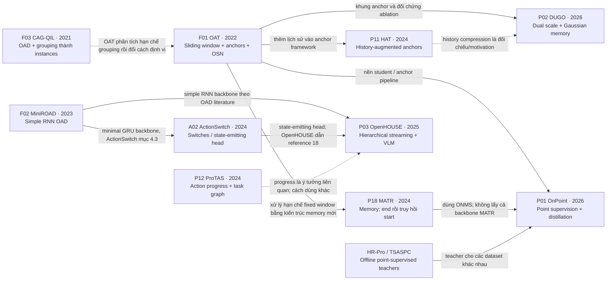

# Thứ tự đọc paper: từ nền tảng đến tự thiết kế và phản biện hệ thống

Cập nhật **2026-11-13**, bản lộ trình v1.0. Đây là **thứ tự đọc chính thức hiện tại**, thay cho các thứ tự tạm 0/0b/3b trước đó. Có **36 bài**, mỗi bài xuất hiện đúng một lần trong bảng thứ tự. PDF/nguồn đã có ở [thư viện](../papers/README.md); xem [bản đồ thành phần](paper_map.md) và [phân tích 9 bài bổ sung](paper_additions.md) khi cần tra cứu.

Mục tiêu học: từ luồng **RGB exocentric**, xác định **toàn bộ một lượt công việc**, giữ cùng lượt qua pause/repair, phát nhiều interval khi nhiều lượt hoàn thành và chỉ quyết định bằng prefix đã quan sát. “Hiểu hết” ở đây được kiểm tra bằng khả năng giải thích, tính/vẽ một ví dụ và nhận ra giả định sai, không bằng số trang đã đọc. Không có lịch đọc nào tự bảo đảm người đọc đã hiểu; các bài tự kiểm ở dưới là điều kiện chuyển chặng.

## 1. Cách dùng và mức ưu tiên

Đi theo số **1 → 36**, với độ sâu ghi trong bảng. **1–19 là nền cốt lõi cho bài toán**, **20–23 hoàn thiện đánh giá và hướng ít nhãn**, **24–36 là đào sâu/mở rộng**. Sau bài 10 có thể chạy/đánh giá baseline causal; sau bài 19 có thể viết thiết kế nghiên cứu và phân tích lỗi. Không cần chờ đọc hết 36 bài mới làm pilot, nhưng phải hiểu đủ chặng liên quan trước khi tuyên bố đã giải quyết thành phần đó.

- **K — đọc kỹ:** hiểu problem/giả định, kiến trúc, mục tiêu loss và inference; tự trace một ví dụ; đọc ablation và metric cùng hạn chế. Với module định dùng, cần hiểu công thức đầu vào/đầu ra và xem code/pseudocode nếu có; không cần chứng minh lại mọi định lý/phụ lục không dùng.
- **C — đọc chọn lọc có kiểm tra:** đọc đúng phần chỉ định; hiểu interface, cơ chế chính, supervision và giới hạn; trả lời câu hỏi ở cột cuối. Muốn sử dụng kỹ thuật trong thí nghiệm thì nâng bài đó lên mức K trước khi triển khai.
- **L — đọc lướt có mục tiêu:** nắm ý tưởng/phạm vi/bằng chứng; chưa dành thời gian tái lập. Cũng phải trả lời được vì sao bài chưa là lời giải cho dự án.

Thứ tự này được xếp theo **prerequisite và mức hữu ích cho dự án**, không xếp theo năm hoặc mAP của các benchmark khác nhau. Mũi tên thứ tự đọc không tự là quan hệ kế thừa model. Các nhánh model có thật được phân biệt ở phụ lục cuối trang.

## 2. Trước bài 1: kiểm tra nền cần thiết

Đọc [problem.md](problem.md), đặc biệt đơn vị công việc và hợp đồng online. Chọn một ví dụ nhất quán, chẳng hạn đóng gói một hộp: lấy hộp → cho đồ → nghỉ → sửa lại → đóng/giao hộp. Các câu hỏi sau là bài tự kiểm, chưa phải task definition đã chốt cho dataset.

| Nền | Phải làm được trước khi đọc tiếp | Nếu chưa làm được |
| --- | --- | --- |
| Mốc thời gian | Phân biệt `start`, `end`, `observed_until`, `emitted_at`; giải thích boundary ở giây 20 nhưng phải tới giây 22 mới đủ bằng chứng. | Xem hợp đồng output trong problem.md; vẽ timeline bằng tay. |
| Tensor/sequence | Đọc `[B,T,D]`, hiểu hidden state, padding mask, timestamp và feature rate khác video FPS. | Xem [model](../videosegmentation/training/model.py) và [data](../videosegmentation/training/data.py); chưa cần thay code. |
| Học có giám sát | Phân biệt logits/probability, BCE/cross-entropy, class imbalance, train/val/test và label leakage. | Tự tính loss/prediction của vài mẫu nhỏ; hiểu threshold chọn trên validation. |
| Temporal metric | Tính tIoU của hai interval, ghép một dự đoán với một GT, tính TP/FP/FN khi có duplicate. | Dùng ví dụ GT `[10,20]`, prediction `[12,22]`: tIoU bằng `8/12 = 2/3`; thêm một bản sao và đếm FP. |
| Mô hình cơ bản | Hiểu một bước GRU, receptive field/causal mask, attention query–key–value và gradient descent. | Xem lại đúng khái niệm còn thiếu; không cần học lại toàn bộ deep learning trước roadmap. |

**Bài kiểm tra không cần paper:** tạo timeline gồm một lượt hoàn thành, một lượt nghỉ rồi làm tiếp, một lượt bỏ dở và một đoạn unknown do che khuất. Ghi đầu ra mong muốn, completion evidence và trường hợp không được đóng lượt ở EOF. Nếu chưa thống nhất được “một lượt” nghĩa là gì, chưa nên chọn model bằng metric.

Đọc ngắn phần [protocol và phản ví dụ](related_work_and_evaluation.md) ngay lúc này: cùng interval nhưng emit khác lúc; spam; gộp hai lượt; EOF/time-only. Việc đọc sớm bản tổng hợp này giúp tránh tối ưu metric sai; PROVIA method được đọc kỹ ở bài 16.

## 3. Thứ tự cốt lõi 1–19

Các phần/§ tính theo **PDF đang lưu trong repo**. Cột cuối là chuẩn hiểu phải kiểm được bằng một ví dụ, không chỉ trả lời “có”.

### Chặng A — Hiểu đúng đầu ra trước khi học kiến trúc

| # | Paper / mức đọc | Phần cần đọc theo thứ tự | Trước khi chuyển bài, phải giải thích/làm được |
| --- | --- | --- | --- |
| **01** | **[F04 — TAS Survey](../papers/foundations/F04_2022_tas_survey.pdf) — C** | §2.1, §2.3–2.4 → §3.2 → §4.1; §3.1 xem feature, §2.2 xem dataset. | Phân biệt TAS, TAL, OAD, GEBD; vẽ được frame features → temporal model → output và nói rõ metric đo gì. |
| **02** | **[P14 — Action Completion](../papers/P14_2018_action_completion.pdf) — C** · [Note đọc](NOTES.md#p14-action-completion) | Introduction/problem, hình minh họa; xem voting method ở mức nguyên lý. | Cho ví dụ action được nhận dạng đúng nhưng goal chưa đạt; chỉ ra vì sao dùng frame sau completion phải ghi nhận thời điểm phát muộn hơn. |
| **03** | **[P13 — IndustReal / PSR](../papers/P13_2024_industreal.pdf) — K** | §3 định nghĩa/metric → ASD/PSR trong benchmark §5 → Table 4. | Viết điều kiện completed step và execution error; đọc F1 cùng delay; giải thích vì sao completed step chưa cung cấp hai biên của whole-task instance. |
| **04** | **[A01 — Online Detection of Action End](../papers/additions/A01_2025_online_action_end.pdf) — C** | Formulation và point-mAP → overview TeSTra/Mamba → Tables 3–4. | Phân biệt end-event và interval; tự matching one-to-one; nói được tolerance đối xứng 1–10 giây có thể chấp nhận báo sớm/trễ thế nào. |

**Mốc A — hiểu bài toán:** viết một trang guideline cho ví dụ của bạn: đơn vị task, start, bằng chứng completed, pause/repair, aborted/unknown và censoring. Cho ba trường hợp **action end có nhưng goal chưa đạt**. Phải giải thích được vì sao A01/P14/P13 có ba đầu ra khác nhau và không thể thay ground truth của nhau.

### Chặng B — Hiểu một hệ thống causal tạo interval như thế nào

| # | Paper / mức đọc | Phần cần đọc theo thứ tự | Trước khi chuyển bài, phải giải thích/làm được |
| --- | --- | --- | --- |
| **05** | **[F02 — MiniROAD](../papers/foundations/F02_2023_miniroad.pdf) — K** | Method/kiến trúc RNN → loss theo timestep → train/inference → ablation. | Viết một bước GRU với hidden state; chỉ ra context ở mỗi timestep lúc train và test; giải thích tại sao cách đặt loss ảnh hưởng kết quả. |
| **06** | **[F03 — CAG-QIL](../papers/foundations/F03_2021_cag_qil.pdf) — C** | Introduction → §3 problem formulation → overview grouping; Q-imitation chỉ cần hiểu vai trò. | Lấy chuỗi frame scores làm ví dụ tick/fragment/merge; giải thích ràng buộc online và proposal đã phát; chưa cần tái lập Q-learning. |
| **07** | **[F01 — OAT](../papers/foundations/F01_2022_oat.pdf) — K** | §1–3 → hình architecture → classification/regression và OSN → evaluation. | Tự vẽ window, anchor queries, cls/reg và OSN; phân biệt proposal end, hiện tại, thời điểm emit; giải thích vì sao NMS cả video không là post-processing online. |
| **08** | **[P18 — MATR](../papers/P18_2024_memory_augmented_transformer.pdf) — K** | §3.2–3.4 → memory update → end/start decoders → memory ablation. | Trace một instance dài hơn window: thông tin nào lưu trong queue, end được phát thế nào, start được truy hồi ở đâu; phân biệt feature memory và video buffer. |
| **09** | **[A02 — ActionSwitch](../papers/additions/A02_2024_actionswitch.pdf) — K** | §3 state/switch formulation và conservativeness loss → §4.3 → F1/proposal analysis. | Tự encode/decode state cho hai instance nối tiếp và hai instance overlap; nói được loss giảm flicker nhưng chưa xác minh goal đạt. |
| **10** | **[P10 — OnlineTAS](../papers/P10_2024_onlinetas.pdf) — K** | §3.2–3.5 → memory/causal backbone → online vs semi-online → post-processing ablation. | Chỉ ra frame nào được dự đoán ở mỗi mode và khi nào kết quả sẵn sàng; giải thích smoothing tăng F1 nhưng có thể làm trễ boundary. |

**Mốc B — hiểu pipeline online:** tự trace trên một stream giả: lượt bắt đầu ở 10, pause ở 18–30, hoàn thành ở 42, xác nhận tại 43. Ghi state/memory/proposal/output theo thời gian. Phải giữ một interval `[10,42]`, ghi `emitted_at >= 43`, không đóng ở 18 và không sinh lại khi sản phẩm còn trong ảnh. Chỉ ra phần nào OAT/MATR/ActionSwitch/OnlineTAS xử lý nguyên bản, phần nào là thích nghi cần kiểm chứng cho task đích.

Đối chiếu [pipeline GRU hiện có](training_pipeline.md): encoder, three heads, masked loss, hidden state qua chunk, decoder, checkpoint và metrics. Giải thích được từng khối đọc input nào và nhãn nào; baseline này chưa phải tái lập MiniROAD hay các paper khác. Đây là lúc có thể chạy smoke/pilot trong khi tiếp tục đọc.

### Chặng C — Từ bước/thao tác sang cấu trúc, lỗi và trạng thái

| # | Paper / mức đọc | Phần cần đọc theo thứ tự | Trước khi chuyển bài, phải giải thích/làm được |
| --- | --- | --- | --- |
| **11** | **[P12 — ProTAS](../papers/P12_2024_protas.pdf) — K** | §3 → §4.1–4.5, đặc biệt APP và task graph → ablation. | Giải thích progress target từ đâu, graph tác động dự đoán thế nào; mô tả pause/rework làm hỏng giả định progress hoặc thứ tự cứng ra sao. |
| **12** | **[P03 — OpenHOUSE](../papers/P03_2025_openhouse.pdf) — K** | §3.1 task hierarchy → §3.3 streaming/context memory/VLM → Table 3 và exo setting. | Tự vẽ substep–step–goal và thời điểm gọi VLM; chỉ ra state head từ ActionSwitch; phân biệt goal description với thời điểm goal achieved. |
| **13** | **[P05 — Online GEBD / ESTimator](../papers/P05_2025_online_gebd.pdf) — C** | Định nghĩa boundary → method prediction error/adaptive threshold → error examples. | Tạo ví dụ đổi thao tác hoặc pause có boundary nhưng chưa completed; nói rõ boundary candidate cần thêm tầng quyết định nào. |
| **14** | **[A03 — VidParse](../papers/additions/A03_2026_vidparse.pdf) — K** | §3.3–3.5 → prototype/graph construction → Table 1 bản v2 → fixed-lag/peak detection. | Liệt kê nhãn train/prototypes/graph vẫn cần dù không update gradient; trace local peak, lag và final commitment; chỉ ra hard graph có thể loại repair hợp lệ. |
| **15** | **[A06 — ESTANet](../papers/additions/A06_2026_estanet.pdf) — C** | Method: 4 GRU detectors, TAD, contexts/voting → §4.1 datasets/metric → ablation. | Giải thích prediction disagreement là error evidence, không là completion; tách whole-session và first-error-truncated setting; biết chỗ cần audit mode filter. |
| **16** | **[P19 — PROVIA](../papers/P19_2026_provia.pdf) — K** | §III protocol → hoàn thành cầu nối Bayes ở mục 5 → §IV-B–IV-E → operating-point tables. | Tách factual state, accepted progress và execution status; cập nhật belief một bước; giải thích hazard/alarm khác completed task; đọc recall cùng false-alarm rate thực. |

**Mốc C — hiểu procedure/state:** vẽ hai sơ đồ tách biệt: (1) graph tác giả dùng cho action/step, (2) vòng đời **task-instance** của dự án. Trace cùng một lượt qua nghỉ → làm sai → sửa → hoàn thành. Nêu chỗ hard graph, progress reset hoặc mismatch detector có thể cắt/đóng sai. Phân biệt fixed-lag của VidParse, factual/accepted state của PROVIA và states/switches của ActionSwitch; không gộp chúng vì cùng có từ “state”.

Phải liệt kê được nhãn/bộ pretrained model/prototypes/graph cần thêm cho từng hướng, phần nào có ở train/test và chi phí trễ có thể phát sinh. Chọn một ablation cùng visual features và ngân sách nhãn để kiểm tra liệu module cấu trúc thực sự có ích.

### Chặng D — Bằng chứng đạt goal và chuyển góc nhìn

| # | Paper / mức đọc | Phần cần đọc theo thứ tự | Trước khi chuyển bài, phải giải thích/làm được |
| --- | --- | --- | --- |
| **17** | **[A09 — State-Change Counterfactuals](../papers/additions/A09_2025_state_change_counterfactuals.pdf) — C** | Method clip/video state-change supervision → Tables 1–2 → downstream architecture. | Nêu actual/counterfactual supervision, tác dụng hard negatives; chỉ ra chỗ full-video/ASFormer cần causal hóa; giải thích EDA tăng nhưng AUC giảm. |
| **18** | **[A04 — SPOC](../papers/additions/A04_2025_spoc.pdf) — C** | §3.2–3.4 pseudo labels/dynamics/model → Tables 2 và 4 → inference assumptions. | Giải thích actionable/transformed và progress theo diện tích; phân biệt causal ordering với causal inference; cho ví dụ assembly tháo ra/làm lại không monotonic. |
| **19** | **[P21 — Unseen-view TAS](../papers/P21_2025_unseen_view_tas.pdf) — C** | §3 losses/protocol → train/test views → exo results và required labels/views. | Thiết kế split theo recording và camera; phân biệt nhiều view lúc train với một view lúc test; giữ riêng tín hiệu vị trí/ROI có ý nghĩa goal. |

**Mốc D — đủ nền để đề xuất nghiên cứu:** viết một thiết kế hai trang có định nghĩa task, split/coverage, baseline temporal-only, một giả thuyết goal-state từ RGB exo, completion decision và protocol. Có ví dụ **thành phẩm có sẵn trước lúc stream bắt đầu**: nhìn thấy trạng thái đúng chưa chứng minh vừa hoàn thành một lượt mới. Có ca repair đảo trạng thái và camera chưa thấy. Nêu điều kiện nào không quan sát được phải trả pending/unknown.

Không gọi “object state + task graph” là novelty chỉ vì mình vừa nghĩ ra: đối chiếu PROVIA, SPOC và counterfactual representation. Điểm phải chứng minh là hiệu quả cụ thể cho cấp lượt/ownership/online exo ở cùng nhãn, compute và latency.

## 4. Thứ tự 20–36: đánh giá, distillation và đào sâu

Bài 20–23 vẫn quan trọng cho cách chấm và thiết kế thí nghiệm; phần taxonomy/metric đã gặp từ survey, nay quay lại để phản biện bằng dự đoán cụ thể. Bài 24–36 hoàn thiện góc nhìn; khi một nhánh thành lựa chọn triển khai, nâng mức đọc lên K cho phần cần dùng.

### Chặng E — Hoàn thiện đánh giá và học với ít nhãn

| # | Paper / mức đọc | Phần cần đọc theo thứ tự | Trước khi chuyển bài, phải giải thích/làm được |
| --- | --- | --- | --- |
| **20** | **[P23 — Range Precision / Recall](../papers/P23_2018_range_precision_recall.pdf) — C** | Định nghĩa existence, overlap, cardinality và positional bias; tính một ví dụ. | Tự chấm trường hợp một interval phủ hai GT, một GT bị split và early reward; biết vì sao range score không đủ cho emitted completion events. |
| **21** | **[P22 — Affiliation Metrics](../papers/P22_2022_affiliation_metrics.pdf) — C** | Motivation → local-distance/affiliation definitions → adversarial examples. | Thiết kế predictor always-on/spam/rất dài để thử metric; nêu giới hạn khi chuyển anomaly ranges sang task instances và zero-duration completion points. |
| **22** | **[P20 — WARI / SMS](../papers/P20_2025_interpretable_segmentation_metrics.pdf) — C** | WARI → bốn loại lỗi SMS → mapping/weighting → synthetic examples. | Phân biệt delay/isolation/transition/missing; nói được khi nào label remapping che sai semantics; giữ latency/t_emit ngoài segmentation score. |
| **23** | **[P01 — OnPoint](../papers/P01_2026_onpoint.pdf) — K** | §3.1–3.8 → teacher/student interfaces → Appendix B decoding/latency; teacher nguyên bản chỉ đọc sâu khi dùng. | Vẽ tensor nào chỉ là train supervision, tensor nào có ở test; phân biệt CAS/CASS/pseudo intervals/point labels và resume/warm-start với teacher–student distillation; giữ student inference causal. |

**Mốc E — hiểu cách chứng minh hiệu quả:** lập bảng ablation và evaluator. Chấm riêng interval one-to-one, timely recall, early false completion, FP/phút, merge/split, unknown/coverage và view. Dùng các counterexample ở mục 6. Với OnPoint, vẽ ranh giới train/test rõ ràng: teacher có thể nhìn video train đầy đủ; student test phải chỉ dùng prefix. Nếu nhãn chưa là nút thắt, giữ OnPoint là hướng mở rộng đã hiểu, chưa cần triển khai teacher.

### Chặng F — Các phương án memory/context để đối chiếu

| # | Paper / mức đọc | Phần cần đọc theo thứ tự | Trước khi chuyển bài, phải giải thích/làm được |
| --- | --- | --- | --- |
| **24** | **[P11 — HAT](../papers/P11_2024_hat.pdf) — K** | §3.4–3.7 history refinement/anchors/loss → history ablation. | So HAT với OAT/MATR: history được nén và inject ở đâu; phân biệt future supervision với future observation. HAT không là prerequisite bắt buộc của MATR/OnPoint. |
| **25** | **[P02 — DUGO](../papers/P02_2026_dugo.pdf) — C** | Dual-scale encoder → Gaussian memory/gating → memory ablation và compute. | Phân biệt stochastic prototypes với posterior task completion; thiết kế đối chứng deterministic memory cùng context/compute. |
| **26** | **[P06 — CMeRT](../papers/P06_2025_cmert.pdf) — C** | §3 diagnosis → §4 context/memory refinement → train/inference. | Phân biệt near-future được dự đoán với future frames được quan sát; so mục tiêu OAD frame-wise với interval/completion cần thêm decoder. |
| **27** | **[P04 — Hierarchical Event Memory](../papers/P04_2025_hierarchical_event_memory.pdf) — C** | Event aggregation/memory update → grounding/prediction branch → accuracy-delay table. | Giải thích event memory giữ gì/loại gì; cần text query ra sao; phân biệt anticipated boundary và achieved completion, không coi negative delay là completion tốt. |
| **28** | **[A07 — ESOM](../papers/additions/A07_2024_esom.pdf) — C** | OVQ2D formulation → discovery/tracking/memory/query → Table 1. | Phân biệt object memory và action memory; nêu đầu vào query patch; dùng success 4,02% ở cấu hình thực và không đưa oracle 81,92% vào claim triển khai. |

**Mốc F — biết chọn memory có lý do:** so HAT/MATR/DUGO/event memory/object memory bằng thông tin được lưu, cách quên, context, supervision/query, dung lượng và latency. Đề xuất một phép thay prefix nhưng giữ đoạn cuối để kiểm tra memory có nhớ đúng lượt hay chỉ dựa vào prior. Không đổi module chỉ vì tên mới hoặc điểm ở dataset khác.

### Chặng G — Mô hình xác suất và prior theo thời gian

| # | Paper / mức đọc | Phần cần đọc theo thứ tự | Trước khi chuyển bài, phải giải thích/làm được |
| --- | --- | --- | --- |
| **29** | **[P15 — BOCPD](../papers/P15_2007_bocpd.pdf) — K** | Run-length definition → recursion/Algorithm 1 → hazard/likelihood → complexity. | Tính growth/reset cho một chuỗi ngắn; giải thích changepoint khác completion, và vì sao không tùy tiện lấy P(run length=0) làm goal score. |
| **30** | **[P17 — Robust BOCPD](../papers/P17_2023_robust_bocpd.pdf) — C** | BOCPD failure under outliers → generalized update → robustness conditions/experiments. | Mô tả outlier và true change khác nhau; nêu đánh đổi giảm FP với delay/bỏ sót. Chỉ đi sâu diffusion score matching nếu thực sự chọn hướng này. |
| **31** | **[P16 — HDP-HSMM](../papers/P16_2013_hdp_hsmm.pdf) — C** | HMM vs HSMM → explicit duration → finite model trước HDP/Gibbs. | Viết duration/hazard của một state; phân biệt action clock, pause clock và task-instance clock; chỉ ra Gibbs toàn chuỗi không phải causal filter. |
| **32** | **[P09 — Bayesian-VSLNet](../papers/P09_2026_bayesian_vslnet.pdf) — C** | Grounding likelihood → §4.2 order prior/Eq.11 → inference timeline. | Tách visual evidence và order prior; chỉ ra prior dùng tổng video/danh sách query phải sửa gì trước streaming; cần VSLNet sâu hơn chỉ khi tái lập nhánh này. |

**Mốc G — hiểu đủ để chọn mô hình xác suất:** viết một recursion hữu hạn nhỏ có observation likelihood, transition và duration; thêm đường pause/repair/unknown. Nói được prior nào chỉ dựa trên train/prefix và prior nào dùng tổng chiều dài test bị cấm. Muốn sử dụng robust update hoặc HDP/Gibbs thật sự phải quay lại mức K cho công thức/phương pháp đó, thay vì chỉ mượn tên.

### Chặng H — Các bài toán lân cận và modality bổ sung

| # | Paper / mức đọc | Phần cần đọc theo thứ tự | Trước khi chuyển bài, phải giải thích/làm được |
| --- | --- | --- | --- |
| **33** | **[P08 — PHGC](../papers/P08_2025_phgc.pdf) — C** | Task verification definition → heterogeneous graph/path/entities → verification metric. | Vẽ video/rule graph; phân biệt pending, violated và verified; giải thích graph completion không phải timestamp hoàn thành công việc. |
| **34** | **[P07 — OZ-TAL / VFEAL](../papers/P07_2026_oz_tal.pdf) — C** | Zero-shot setting → VLM features/memory/background → frame grouping. | Phân biệt unseen class, unseen view và goal completion; nêu dữ liệu/text assumptions mới và failure khi actionness tụt ở pause. |
| **35** | **[A05 — DETACH](../papers/additions/A05_2025_detach.pdf) — C** | Spatial/temporal alignment → modalities → downstream evaluation protocol. | Nói rõ số F1 đo sensor encoder, không phải RGB localization; liệt kê ambient sensors/sync cần thêm; giải thích online clustering không chứng minh toàn pipeline causal. |
| **36** | **[A08 — WEM Framework](../papers/additions/A08_2026_wem_framework.pdf) — L** | Figure 1 và §3 event-card/memory schema → §4 outlook. | Mô tả evidence-linked event card; chỉ ra xử lý offline và chưa có benchmark. Lấy schema/provenance làm ý tưởng, không gọi đây là baseline online đã kiểm chứng. |

**Mốc H — hoàn thành vòng đọc toàn bộ thư viện:** mỗi bài có một phiếu ở mục 7. Lập bảng cuối “dùng / làm đối chứng / để sau”, kèm lý do về objective, data/label, causal access và compute. Việc đã hiểu một nhánh không bắt buộc biến nó thành input yêu cầu của ứng dụng. Các claim mới ngoài phạm vi tài liệu đã kiểm tra vẫn cần rà literature thêm.

## 5. Cầu nối toán trước PROVIA và nhánh xác suất

Cầu nối này là bài tập nền của dự án, không phải mô hình nguyên bản hoặc kết quả mới của PROVIA. Cần hiểu **Bayes filter** trước bài 16; BOCPD/HDP-HSMM không phải prerequisite bắt buộc của PROVIA. Trước bài 29–32 thì mở rộng thêm run length và duration.

Cho hai giả thuyết `active`, `completed`, prior `[0.8, 0.2]`. Quan sát có likelihood `[0.1, 0.9]`. Tự tính unnormalized weights `[0.08, 0.18]`, rồi chuẩn hóa thành `[0.3077, 0.6923]`. Trả lời tại sao posterior completed chưa tự đồng nghĩa nên phát event: còn chi phí FP, mức chắc chắn, calibration và bằng chứng của đúng lượt. Không nhân các score cùng nguồn ảnh như thể độc lập; lặp cùng bằng chứng qua nhiều frame tương quan có thể làm quá tự tin.

Phải phân biệt: observation likelihood, state transition prior, posterior belief, hazard phụ thuộc `Δt`, threshold/decision rule và emission clock. Thêm một transition active → paused → active mà **không đổi task-instance ID**; sau completed, nhìn lại cùng sản phẩm không sinh event thứ hai. Filtering nhìn prefix; smoothing/Gibbs nhìn cả chuỗi hoặc fixed-lag cần được báo đúng quyền thông tin và độ trễ.

Khi đọc P19 §IV, map từng biến/transition sang đúng nghĩa **procedure state và execution status của tác giả** trước. Chỉ sau khi hiểu bản gốc mới vẽ biến thể goal-level cho dự án; đổi tên state không chứng minh ngữ nghĩa đã đúng.

## 6. Bài tự kiểm tích lũy và đáp án tối thiểu

Dùng một task definition cố định cho mọi bài tập. Chỉ chuyển chặng khi có thể giải thích lại không nhìn tóm tắt và chỉ được vị trí bằng chứng trong PDF cho cơ chế đang nói. Nếu vướng, quay lại prerequisite cụ thể; không đọc thêm bài mới để né phần chưa hiểu.

| Câu hỏi / tình huống | Đáp án tối thiểu cần đạt |
| --- | --- |
| GT `[10,20]`, dự đoán `[12,22]`; thêm một bản sao dự đoán | tIoU `2/3`; matching one-to-one tối đa một TP, bản sao khác ID là FP. Không âm thầm bỏ duplicate do model sinh. |
| Cùng interval đúng nhưng emit tại 21 và 40, GT end=20 | Hình học interval giống nhau; delay khác 1 và 20 giây. Với deadline 2 giây, chỉ event đầu timely. Latency phải đi với recall/FP. |
| GT end=20; dự đoán end=19.5, emit=19.7 | Có thể qua tIoU và endpoint tolerance, nhưng không có bằng chứng completion đúng thời điểm; phải tính early false completion theo protocol của dự án. |
| Một lượt `[10,42]` nghỉ ở `[18,30]` | Membership toàn lượt giữ qua pause; motion/actionness giảm không đủ để đóng completed. Không tự gọi pause là aborted. |
| Hai lượt `[10,20]`, `[20,30]` cùng lớp, dự đoán `[10,30]` | Frame class có thể đẹp nhưng mất một identity/boundary. Interval matching/count/merge phải phản ánh; không credit một event cho hai lượt. |
| Camera bật lên đã thấy thành phẩm; EOF sau một lượt chưa xong | Thành phẩm tồn tại không là bằng chứng về một completion mới; EOF không tạo completed. Phân biệt unknown/censored/ongoing theo bằng chứng. |
| Peak tại 20 cần frame tới 22 để xác nhận; chunk chỉ sẵn ở 24 | Không ghi emit ở 20; phải ghi thời điểm dữ liệu/quyết định thực sự sẵn sàng, ít nhất 24 cộng processing trong setting chunk đó. |
| Teacher train dùng cả video; student test dùng prefix | Có thể là online hợp lệ. Nếu feature encoder/test normalization/decoder dùng tương lai chưa tới thì vẫn leakage, dù temporal head mang tên causal. |
| Điểm benchmark tăng sau smoothing/task graph | Chưa đủ kết luận. Audit causal access/delay, label/graph budget, ca repair và operating point trước khi gọi là cải tiến. |
| Cùng trial có ego/exo, camera khác và nhiều clip copy | Giữ cùng group trong một split; validation/test không trở thành tài liệu dựng prototypes/graph hoặc tune threshold. |

**Bốn sản phẩm học bắt buộc:** (1) task/annotation guideline; (2) timeline và sơ đồ causal inference; (3) bảng so cơ chế + nhãn/compute/latency; (4) kế hoạch ablation/evaluator với phản ví dụ. Có đủ bốn sản phẩm và qua các mốc mới có cơ sở nói mình hiểu để thiết kế nghiên cứu; chưa đồng nghĩa đã tái lập hoặc chứng minh hiệu quả trên video thật.

## 7. Phiếu đọc thống nhất cho mỗi paper

Tạo một phiếu ngắn khi đọc mỗi bài; dùng cùng định nghĩa để so sánh. Đây là mẫu ghi chú học, chưa phải kết quả được điền sẵn.

```text
Paper / ID / phiên bản:
1. Problem: input, output ở cấp nào, metric và quyền nhìn dữ liệu?
2. Motivation: failure case nào của hướng trước dẫn tới thiết kế này?
3. Mechanism: tự vẽ forward + loss/supervision + inference/update rule.
4. Train/test: nhãn, features, graph/prototypes, future access ở đâu?
5. Evidence: một comparison cùng bảng/setting + một ablation; ghi metric/table/page.
6. Limit: một phản ví dụ cho task online exo toàn lượt; phân biệt tác giả nêu và mình suy luận.
7. Transfer: thành phần nào dùng được; cần thay nhãn/decoder/causal policy gì?
8. Self-check: tự giải một ví dụ, còn câu hỏi/công thức nào chưa hiểu?
Decision: dùng / baseline đối chứng / tham khảo; bằng chứng và chi phí còn thiếu.
```

Với survey/metric/conceptual framework, thay mục 3 bằng taxonomy/định nghĩa/phương pháp chấm hoặc memory schema; thay gain detector ở mục 5 bằng phân tích/counterexample phù hợp. Không bịa một số cải thiện cho paper không có benchmark. Không so mAP interval với frame-mAP, pixel IoU, error F1 hoặc sensor classification F1 như cùng một đại lượng.

Với mức K, hãy trace cả **một lần train** và **một bước inference**, chỉ ra module nào giữ state và khi nào output thành final. Có thể đối chiếu code hiện tại để học interface, nhưng phải phân biệt baseline repo với tái lập paper. Không bắt buộc tái hiện mọi số liệu để hiểu bài; muốn dựa vào gain cho kết luận nghiên cứu thì phải kiểm chứng thực nghiệm tương ứng.

## 8. Phụ lục: quan hệ phát triển đã đối chiếu

Phần này giữ bằng chứng quan hệ giữa một số paper, không tạo thêm một thứ tự đọc khác. Số thứ tự học nằm duy nhất ở bảng 1–36 phía trên. Nguồn gốc và giới hạn của các bài xem [khảo sát chính](literature_review.md), [bổ sung](paper_additions.md) và [manifest PDF](../papers/README.md).


**Nét liền:** sử dụng thành phần hoặc phát triển rõ từ hướng trước, được ghi trên cạnh; không mặc định cùng codebase. **Nét đứt:** motivation/ý tưởng liên quan hoặc thứ tự đọc hữu ích; không khẳng định kế thừa kiến trúc.



Các quan hệ chính và bằng chứng:

| Quan hệ | Đã kiểm tra ở đâu? | Hệ quả cho việc đọc |
| --- | --- | --- |
| OAT → HAT | HAT intro, §3.5 và references [20]: anchor framework, history augmentation, decoder. [HAT](https://arxiv.org/abs/2408.06437). | Đọc OAT trước HAT. |
| OAT → MATR | MATR intro phân tích fixed window của OAT; §3.2–3.4 đưa memory/decoding mới. [MATR](https://arxiv.org/abs/2408.02957). | OAT là nền khái niệm; MATR là kiến trúc mới, không chỉ một module gắn vào HAT. |
| OAT + ONMS của MATR + teacher → OnPoint | OnPoint §3.2, §3.5, §3.8; [hướng dẫn chính thức](https://sakibreza.github.io/OnPoint/implementation/) §1/§4 khuyên bắt đầu từ OAT. | **Không cần HAT → MATR → OnPoint như một chuỗi bắt buộc.** Chỉ phần ONMS của MATR là phụ thuộc cụ thể nêu ở đây. |
| OAT/history methods → DUGO | DUGO §II đối chiếu OAT/HAT; §III encoder/memory; ablation thêm module trên OAT. [DUGO](https://arxiv.org/abs/2610.41402). | OAT → HAT → DUGO là thứ tự học tốt; không khẳng định DUGO lấy nguyên backbone/code HAT. |
| MiniROAD → OpenHOUSE | OpenHOUSE §3.3.1, implementation details: simple RNN backbone theo [2] MiniROAD. [OpenHOUSE](https://openaccess.thecvf.com/content/ICCV2025/papers/Kang_Open-ended_Hierarchical_Streaming_Video_Understanding_with_Vision_Language_Models_ICCV_2025_paper.pdf). | MiniROAD là phần đọc trước ngắn nếu chưa hiểu OAD/RNN. |
| MiniROAD → ActionSwitch → OpenHOUSE | ActionSwitch §4.3: simple GRU theo [1] MiniROAD. OpenHOUSE §3.3.1 dẫn [18] ActionSwitch cho state-emitting head và loss. | **Bổ sung prerequisite ActionSwitch trước OpenHOUSE**, cụ thể hơn việc chỉ đọc MiniROAD hoặc ProTAS. |
| ProTAS ↔ OpenHOUSE | OpenHOUSE §3.3.1 dẫn prior progress [32] nhưng phân biệt cách dùng progression drops cho boundary. | Đọc ProTAS để hiểu thuật ngữ và giả định progress; không vẽ cạnh kế thừa trực tiếp chỉ vì cùng có progress head. |

**PROVIA là nhánh cần đọc riêng**, không xem nó là “bản nâng cấp MATR/OpenHOUSE”. IndustReal/PSR cung cấp ngữ nghĩa/benchmark hữu ích trước khi đọc, nhưng cùng dataset hoặc cùng chủ đề không chứng minh cùng kiến trúc. Tương tự, P20/P22/P23 là nhánh evaluator, không phải tiền thân model localization.
