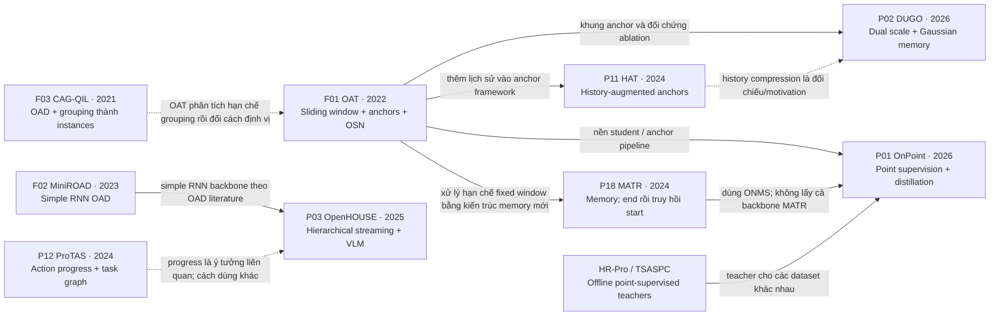

# Lộ trình đọc và quan hệ phát triển giữa các paper

Cập nhật **2026-11-13**. [Bản đồ 23 bài](paper_map.md) phân nhóm theo thành phần; tài liệu này bổ sung **thứ tự học** và **quan hệ phát triển đã đối chiếu method/related work**. Có thêm ba PDF nền F01–F03 ở [papers/foundations](../papers/foundations/README.md), giữ riêng với tập P01–P23 để không ngầm đổi phạm vi ma trận đã công bố.

## 1. Bắt đầu từ bài nào?

**Với dự án này, nên bắt đầu đọc kỹ OAT (ECCV 2022) cho nhánh localization.** Trước đó đọc ngắn phần định nghĩa completed step trong P13 và attempted/achieved trong P14 để không học nhầm đầu ra. OAT làm rõ sliding window, temporal anchors, instance supervision và post-processing online; đó là kiến thức dùng lại khi đọc HAT, MATR và OnPoint. [Paper OAT](https://www.ecva.net/papers/eccv_2022/papers_ECCV/papers/136940640.pdf), §1–3.

Nếu hỏi mốc đặt bài toán On-TAL trong nhánh này: **CAG-QIL (ICCV 2021)** là bài sớm được OAT §2 dẫn là công trình định nghĩa On-TAL. CAG-QIL gom các dự đoán frame thành action instances; OAT đổi hướng sang anchor-based instance prediction để xử lý fragmentation/merge. Có thể chỉ đọc abstract, introduction và problem formulation của CAG-QIL trước; chưa cần đào sâu Q-imitation learning để hiểu OAT. Đây là lịch sử nhánh được đối chiếu, không phải kết luận rằng CAG-QIL khởi đầu mọi nghiên cứu online video. [CAG-QIL](https://openaccess.thecvf.com/content/ICCV2021/papers/Kang_CAG-QIL_Context-Aware_Actionness_Grouping_via_Q_Imitation_Learning_for_Online_ICCV_2021_paper.pdf).

OAT có cả hướng phát hiện sớm/anticipation; khi chuyển sang dự án, không coi dự báo end tương lai là bằng chứng đã hoàn thành. Đọc cả quy tắc post-processing và thời điểm phát, không chỉ hình backbone.

## 2. Lộ trình chính: đọc vừa đủ trước khi mở nhánh

Đây là **khuyến nghị học cho dự án**, không phải chuỗi kế thừa kiến trúc. Mũi tên “đọc trước” không có nghĩa bài sau lấy code từ bài trước.

| Thứ tự | Bài và mức đọc | Cần lấy được gì? | Trước đó cần gì? |
| --- | --- | --- | --- |
| 0 | [P14 Action Completion](../papers/P14_2018_action_completion.pdf): intro/problem; [P13 IndustReal](../papers/P13_2024_industreal.pdf): §3 và ví dụ lỗi | Attempted khác achieved; completed step khác action end; F1 cần đi cùng delay. Chưa cần đọc kỹ CNN–LSTM cũ của P14. | Không cần paper video trước đó. |
| 1 | [F03 CAG-QIL](../papers/foundations/F03_2021_cag_qil.pdf): đọc lướt; **[F01 OAT](../papers/foundations/F01_2022_oat.pdf): đọc kỹ §1–3** | OAD → On-TAL; vì sao grouping frame dễ tick/fragment/merge; window, anchors, cls/reg và OSN. | Hiểu feature sequence, Transformer encoder/decoder và interval IoU ở mức cơ bản. |
| 2 | **[P18 MATR](../papers/P18_2024_memory_augmented_transformer.pdf)**: method và ablation | Từ window ngắn sang memory; phát end rồi truy hồi start; ONMS. Liên hệ việc trả toàn đoạn quá khứ khi vừa nhận ra hoàn thành. | OAT. Không bắt buộc HAT. |
| 3 | [F02 MiniROAD](../papers/foundations/F02_2023_miniroad.pdf): method/figure, có thể lướt | RNN causal cho nhãn frame; cơ sở đơn giản để hiểu streaming module và train/inference context. | Chỉ cần GRU/RNN. Có thể bỏ qua ở vòng đầu nếu đã nắm OAD. |
| 4 | **[P12 ProTAS](../papers/P12_2024_protas.pdf)**: §3–4; **[P03 OpenHOUSE](../papers/P03_2025_openhouse.pdf)**: §3 và thí nghiệm | Progress/task graph; substep–step–goal; boundary liền nhau; cách streaming module gọi VLM. | MiniROAD hỗ trợ đọc backbone OpenHOUSE; ProTAS giúp hiểu progress. Đây không phải tuyên bố OpenHOUSE là bản mở rộng trực tiếp của ProTAS. |
| 5 | **[P19 PROVIA](../papers/P19_2026_provia.pdf)**: §III đọc sớm, §IV đọc kỹ sau các bài trên | Whole-trial protocol, timing-only controls; factual state khác accepted progress; filtering và sequential alarms. | Định nghĩa step/completion của P13, segmentation và Bayes filtering cơ bản. Không bắt buộc học toàn bộ HDP-HSMM. |
| 6 | **[P01 OnPoint](../papers/P01_2026_onpoint.pdf)**: §3 và Appendix B khi cần ít nhãn | Offline teacher → online student; pseudo segments, CAS/CASS, anticipation distillation và direct point loss. | OAT cho student; MATR §3.4 cho ONMS. Teacher HR-Pro/TSASPC chỉ cần đi sâu khi chọn/tái lập teacher. |

Nếu chỉ đủ thời gian cho một vòng: **P13 §3 → OAT → MATR → ProTAS → OpenHOUSE → PROVIA**. P14 và MiniROAD là phần đọc ngắn hỗ trợ; OnPoint để sau khi đã hiểu baseline online và thấy nhãn là nút thắt. §III PROVIA nên xem ngay từ đầu để khóa cách đánh giá, nhưng không cần bắt đầu bằng toàn bộ toán của bài.

## 3. Graph quan hệ phát triển: có nhánh, không phải một hàng thẳng

**Nét liền:** sử dụng thành phần hoặc phát triển rõ từ hướng trước, được ghi trên cạnh; không mặc định cùng codebase. **Nét đứt:** motivation/ý tưởng liên quan hoặc thứ tự đọc hữu ích; không khẳng định kế thừa kiến trúc.

Các quan hệ chính và bằng chứng:

| Quan hệ | Đã kiểm tra ở đâu? | Hệ quả cho việc đọc |
| --- | --- | --- |
| OAT → HAT | HAT intro, §3.5 và references [20]: anchor framework, history augmentation, decoder. [HAT](https://arxiv.org/abs/2408.06437). | Đọc OAT trước HAT. |
| OAT → MATR | MATR intro phân tích fixed window của OAT; §3.2–3.4 đưa memory/decoding mới. [MATR](https://arxiv.org/abs/2408.02957). | OAT là nền khái niệm; MATR là kiến trúc mới, không chỉ một module gắn vào HAT. |
| OAT + ONMS của MATR + teacher → OnPoint | OnPoint §3.2, §3.5, §3.8; [hướng dẫn chính thức](https://sakibreza.github.io/OnPoint/implementation/) §1/§4 khuyên bắt đầu từ OAT. | **Không cần HAT → MATR → OnPoint như một chuỗi bắt buộc.** Chỉ phần ONMS của MATR là phụ thuộc cụ thể nêu ở đây. |
| OAT/history methods → DUGO | DUGO §II đối chiếu OAT/HAT; §III encoder/memory; ablation thêm module trên OAT. [DUGO](https://arxiv.org/abs/2610.41402). | OAT → HAT → DUGO là thứ tự học tốt; không khẳng định DUGO lấy nguyên backbone/code HAT. |
| MiniROAD → OpenHOUSE | OpenHOUSE §3.3.1, implementation details: simple RNN backbone theo [2] MiniROAD. [OpenHOUSE](https://openaccess.thecvf.com/content/ICCV2025/papers/Kang_Open-ended_Hierarchical_Streaming_Video_Understanding_with_Vision_Language_Models_ICCV_2025_paper.pdf). | MiniROAD là phần đọc trước ngắn nếu chưa hiểu OAD/RNN. |
| ProTAS ↔ OpenHOUSE | OpenHOUSE §3.3.1 dẫn prior progress [32] nhưng phân biệt cách dùng progression drops cho boundary. | Đọc ProTAS để hiểu thuật ngữ và giả định progress; không vẽ cạnh kế thừa trực tiếp chỉ vì cùng có progress head. |

**PROVIA là nhánh cần đọc riêng**, không xem nó là “bản nâng cấp MATR/OpenHOUSE”. IndustReal/PSR cung cấp ngữ nghĩa/benchmark hữu ích trước khi đọc, nhưng cùng dataset hoặc cùng chủ đề không chứng minh cùng kiến trúc. Tương tự, P20/P22/P23 là nhánh evaluator, không phải tiền thân model localization.

## 4. Các nhánh chỉ mở khi cần

| Khi nào cần? | Thứ tự | Không cần làm trước |
| --- | --- | --- |
| Thử history representation tốt hơn | OAT → P11 HAT → P02 DUGO; P18 MATR đọc như nhánh đối chứng | Không cần toàn bộ VLM/verification. |
| Thêm teacher kiểu OnPoint | OAT → P01 OnPoint; đọc HR-Pro hoặc TSASPC theo teacher thực sự dùng | Không bắt buộc đọc hết cả hai teacher hoặc HAT. HR-Pro/TSASPC chưa nằm trong thư viện PDF hiện tại; nguồn triển khai được dẫn ở OnPoint appendix. |
| Muốn mô hình xác suất | P15 BOCPD → P17 Robust BOCPD; HMM/HSMM cơ bản → phần explicit duration P16 | Không cần HDP/Gibbs đầy đủ nếu chỉ muốn thử finite-state causal filtering. |
| Xem bài text grounding | P04 cho event memory/online query; P09 khi thật sự cần order priors | Không cần để bắt đầu single-task detector đã cấu hình. |
| Chuyển camera exo | P21 representation/protocol unseen-view sau khi đã chọn causal baseline | Không cần trước khi hiểu interval/goal semantics; cần dữ liệu view phù hợp để thử. |
| Thiết kế evaluator | P19 §III → P23 range definitions → P22 metric gaming → P20 error diagnosis | Không cần đọc hết method của các detector trước. |

## 5. Cách đọc từng bài để không bị cuốn theo toàn bộ tài liệu tham khảo

Vòng đầu đọc abstract → intro → hình pipeline → problem definition → inference rule. Ghi lại bốn điều: **input có quyền nhìn gì, output ở cấp nào, khi nào phát quyết định, supervision cần gì**. Sau đó mới đọc losses, ablation và kết quả.

Chỉ quay về bài cũ khi không hiểu một module thực sự được dùng lại, một thuật toán inference quyết định đầu ra, hoặc một metric/protocol ảnh hưởng kết luận. Bài được liệt kê trong bảng baseline chưa tự là prerequisite. Đặc biệt phân biệt **OSN của OAT** với **ONMS dùng ở MATR/OnPoint**, và phân biệt future supervision lúc train với truy cập future frames lúc test.

Đây là lộ trình ưu tiên, không phải điều kiện bắt buộc phải đọc hết trước khi huấn luyện baseline. Mỗi bài nên kết thúc bằng một dòng “mượn được gì cho whole-task online exo” và một dòng “vẫn thiếu gì”; đối chiếu lại [ma trận thành phần](paper_map.md) trước khi quyết định thêm module.
